# Habit Tracker

Aplicação para realizar o cadastro de hábitos diários e registrar aquilo que foi feito.

## Tecnologias

- Java
- PostgreSQL
- Spring Boot
- Swagger (springdoc)
- React (ferramenta: Vite)
- TypeScript
- CSS

## Funcionalidades

- Cadastro, edição e remoção de hábitos, com descrição e motivo opcionais.
- Marcação e desmarcação de um hábito pelo checkbox, no dia escolhido no calendário.
- Bloqueio de registros duplicados para o mesmo hábito na mesma data.
- Remoção de um hábito junto com os registros dele, com confirmação antes.
- Validação de nome e categoria no front-end e no back-end.
- Mensagens de erro na tela, caso o back-end recuse alguma informação enviada pelo front-end.

## Demonstração

### Tela principal

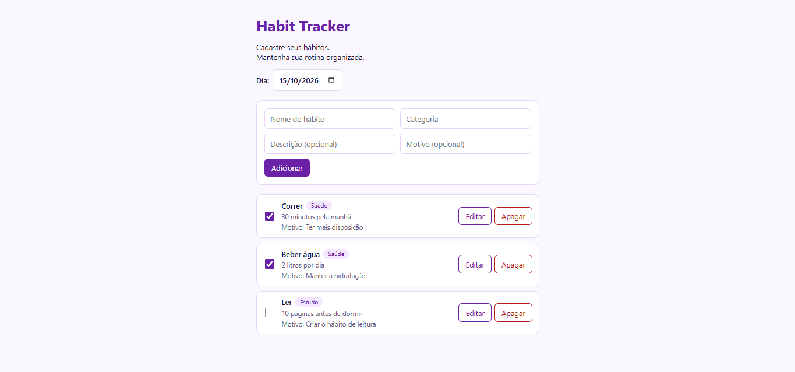

### Editando um hábito

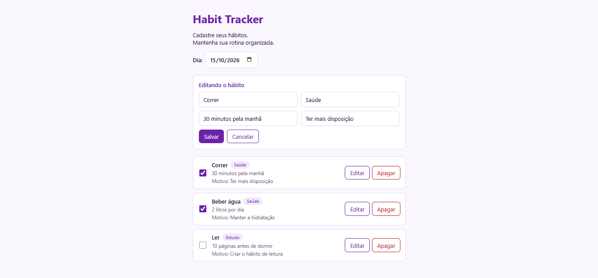

### Validação do formulário

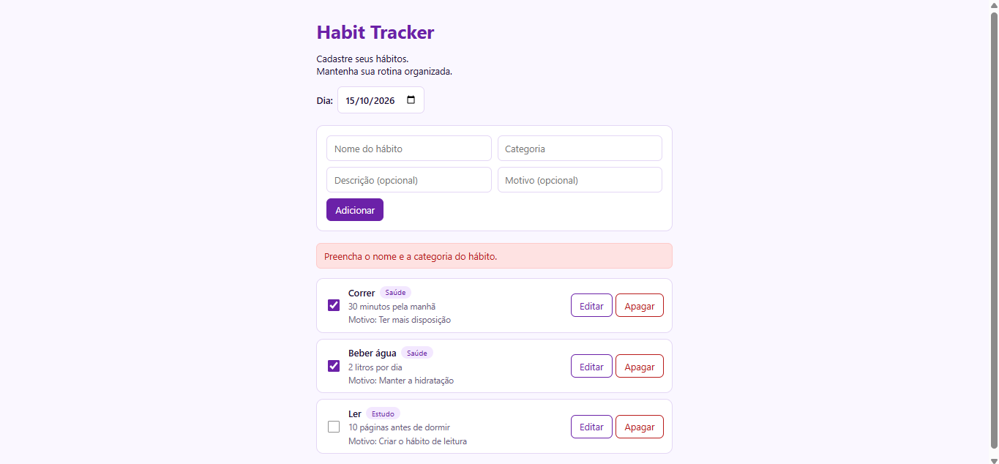

## Arquitetura

O projeto tem três partes: um banco de dados PostgreSQL, que guarda os hábitos e os registros diários; uma API REST em Java com Spring Boot; e um front-end em React, que consome essa API. O back-end segue uma arquitetura em camadas (Model, Repository, Service e Controller), em que cada camada tem uma responsabilidade.

### Model

Define, em Java, a estrutura de cada entidade do sistema: seus campos, tipos e relacionamentos (como o @ManyToOne entre Habit e DailyLog). É a partir dessas classes, anotadas com @Entity, @Id e @JoinColumn, que o Hibernate mapeia os objetos Java às tabelas do banco de dados.

### Repository

Camada composta por interfaces que estendem JpaRepository, declarando os métodos de acesso ao banco de dados (como findAll, save e deleteById), sem exigir implementação manual. O Spring Data JPA gera automaticamente essa implementação em tempo de execução, utilizando o Hibernate para traduzir as chamadas em comandos SQL.

### Service

Camada que concentra as regras de negócio da aplicação, atuando como intermediária entre Controller e Repository. É nela que ficam implementadas validações específicas do domínio — como a checagem de existência de um hábito antes de uma atualização, e o bloqueio de registros duplicados para o mesmo hábito na mesma data. Quando uma regra é violada, o Service lança uma exceção, que é tratada pela camada de exceções antes de retornar ao Controller.

Ao apagar um hábito, o Service remove também os registros diários dele, na mesma transação (@Transactional): ou tudo é apagado, ou nada é. Assim, nenhum registro fica sem hábito.

### Controller

Camada responsável por expor os endpoints REST e lidar com as requisições HTTP, implementando o CRUD completo (criação, leitura, atualização e remoção) para cada entidade. Recebe os dados da requisição, valida o hábito recebido (@Valid, com @NotBlank no nome e na categoria) e repassa ao Service para processamento, devolvendo a resposta ao cliente com o código de status HTTP apropriado.

Erros lançados pelo Service são interceptados pela camada de exceções (GlobalExceptionHandler), que os converte em respostas padronizadas (como 404 e 409), sem expor detalhes internos do sistema. Quando falta o nome ou a categoria de um hábito, o Spring responde com 400 antes de a requisição chegar ao Service.

### Organização do front-end

O front-end fica na pasta `frontend` e é dividido em arquivos, cada um com uma responsabilidade:

- `App.tsx`: guarda o estado da tela e decide o que fazer a cada ação.
- `api.ts`: concentra as chamadas ao back-end.
- `datas.ts`: funções de data (o dia de hoje e a formatação).
- `types.ts`: descreve o formato dos dados (`Habit` e `DailyLog`).
- `components/HabitItem.tsx`: desenha a linha de cada hábito na lista.

## Modelagem do banco de dados

**habit**
- id (PK)
- name
- category
- description
- reason

**daily_log**
- id (PK)
- date
- completed
- habit_id (FK → habit.id)

## Endpoints da API

Com o back-end rodando, a documentação interativa fica em `http://localhost:8080/swagger-ui/index.html`.

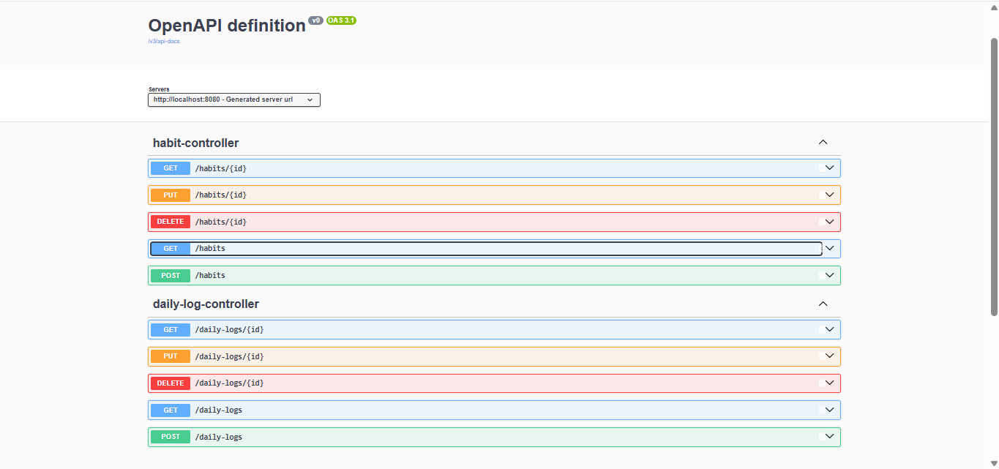

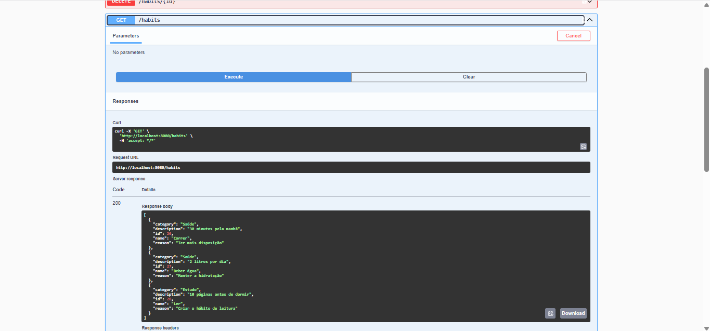

### Habit

- GET /habits - lista todos os hábitos.
- GET /habits/{id} - busca hábito específico.
- POST /habits - cria um novo hábito. Responde 400 se faltar nome ou categoria.
- PUT /habits/{id} - atualiza um hábito existente. Responde 400 se faltar nome ou categoria.
- DELETE /habits/{id} - deleta um hábito específico e os registros diários dele.

### DailyLog

- GET /daily-logs - lista todos os registros diários.
- GET /daily-logs/{id} - busca um registro específico.
- POST /daily-logs - cria um novo registro.
- PUT /daily-logs/{id} - atualiza um registro existente.
- DELETE /daily-logs/{id} - deleta um registro.

## Como rodar o projeto

### Pré-requisitos

- Java (versão 17)
- Maven
- PostgreSQL
- Node.js

### Back-end

1. Clone o repositório
2. Crie um banco de dados PostgreSQL chamado `habits_tracker`

   > **Obs:** caso prefira outro nome, altere a URL no `application.properties.example`, trocando `habits_tracker` pelo nome escolhido. Exemplo: `jdbc:postgresql://localhost:5432/nome_do_banco`

3. Copie o arquivo `application.properties.example` (em `src/main/resources`) e renomeie a cópia para `application.properties`
4. No novo arquivo, ajuste usuário e senha de acordo com sua configuração local do PostgreSQL
5. Execute o projeto com `./mvnw spring-boot:run`

### Front-end

Com o back-end e o banco de dados rodando, abra outro terminal e execute:

1. Entre na pasta do front: `cd frontend`
2. Instale as dependências: `npm install`
3. Inicie o servidor: `npm run dev`
4. Acesse `http://localhost:5173`

> **Obs:** o front precisa rodar na porta `5173`, que é a origem liberada no CORS do back-end.

## Testes da API (Postman)

### Criando um hábito

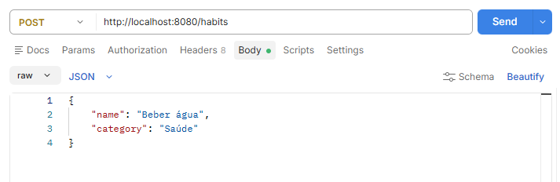
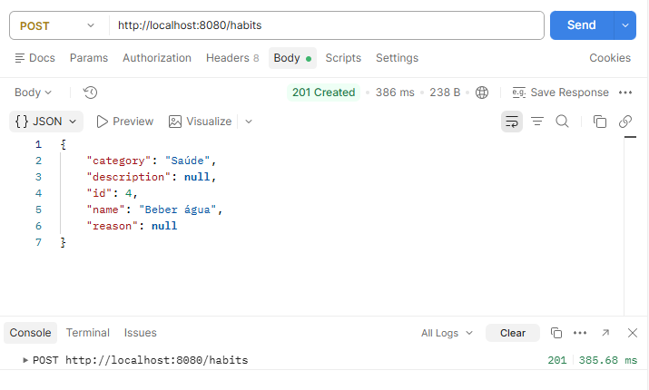

### Listando hábitos

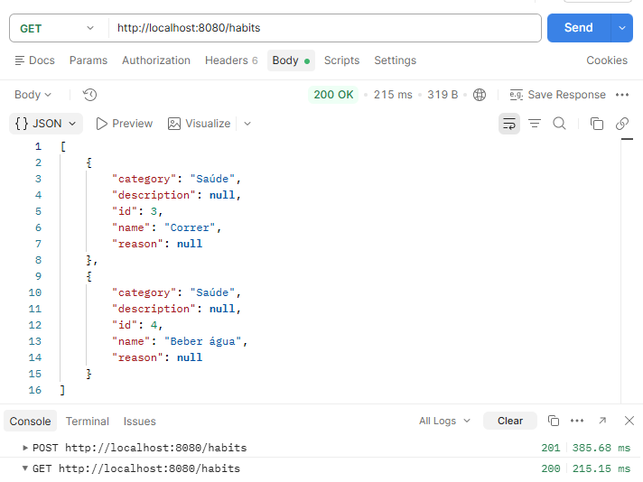

### Buscando um hábito específico

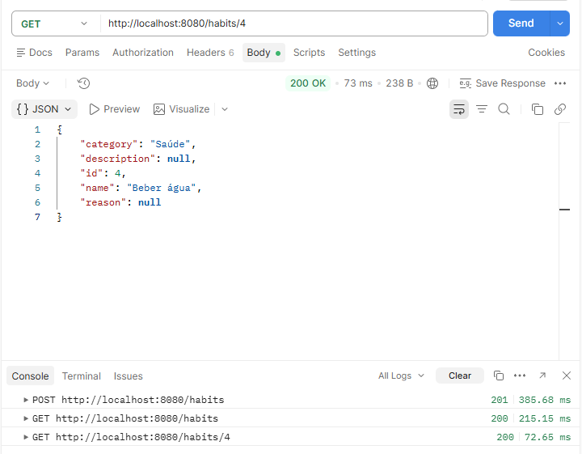

### Registrando a conclusão de um hábito

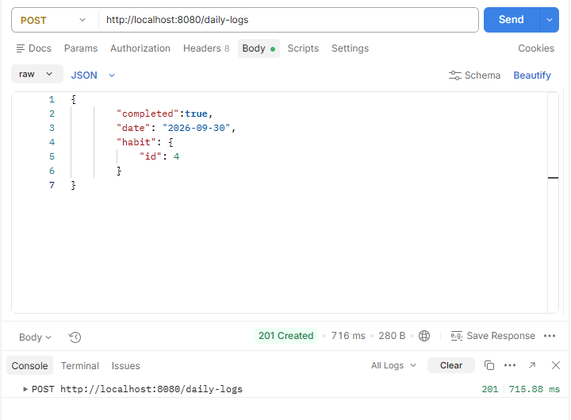

### Bloqueio de duplicidade

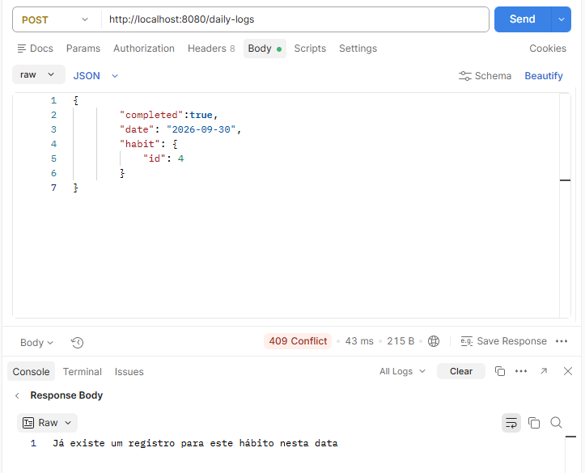

### Tratamento de recurso não encontrado

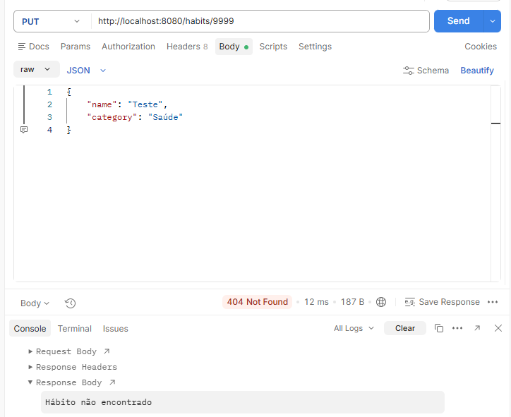

## Próximos passos

- Sequência de dias seguidos.
- Visão da semana, numa grade.
- Login e mais de um usuário.